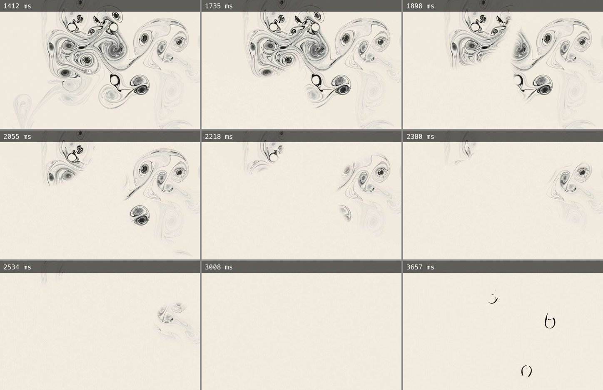

# Plate derivatives

The venue authors four kinds of local derivative from the publisher's files, offline, so the
plates can rest, move and magnify without fetching a 100 MB film or a 36 MB master. Every
derivative is cut from a hash-verified published source, recorded with that source's hash,
published under a content-addressed name, and bound to an interpretation at read time only
when token, seed and hashes all agree. No pixel is tinted, cropped, filtered or re-timed;
the published files themselves are never written.

| Derivative                                                                   | Script                                          | Registry                                    | Files                  |
| ---------------------------------------------------------------------------- | ----------------------------------------------- | ------------------------------------------- | ---------------------- |
| Catalogue excerpt, 8 s at 640 px, 30 fps (seconds 6–14 of the Ink film)      | `scripts/build-collection-previews.mjs`         | `src/lib/art/collection-previews.json`      | `public/art/previews/` |
| Settling clip, the final 480 frames at 1280 × 828, 60 fps, both expressions  | `scripts/build-plate-clips.mjs`                 | `src/lib/art/plate-clips.json`              | `public/art/clips/`    |
| Settling rung, the same 480 frames at 640 × 414 for a card, both expressions | `scripts/build-plate-clips.mjs`                 | `src/lib/art/plate-clips.json`, on its clip | `public/art/clips/`    |
| Opening clip, the first 600 frames at 1280 × 828, 60 fps, hero works only    | `scripts/build-plate-clips.mjs --opening <ids>` | `src/lib/art/plate-clips.json`              | `public/art/clips/`    |
| Still ladder, 1280 × 828 and 1920 × 1242 WebP from the 16-bit master         | `scripts/build-still-ladder.mjs`                | `src/lib/art/still-ladder.json`             | `public/art/stills/`   |
| Plate records: ground tone, edge flag, weighted centre, detail windows       | `scripts/build-plate-records.mjs`               | `src/lib/art/plate-records.json`            | —                      |

`scripts/lib/origin.mjs` is what they share: the one origin, bounded JSON reads with
Retry-After backoff, the token list, manifest validation, the byte-range relay FFmpeg reads
through (so it can never follow a redirect or pull a whole original), a verified asset cache
under `.cache/art/` (gitignored), content-addressed publication, atomic registry writes under
a lock. `scripts/lib/raster.mjs` decodes rasters without colour management and compares them.

```sh
npm run art:clips                      # settling clips and their rungs, every indexed work, both expressions
npm run art:clips -- --opening 23 31 35 # opening clips for the works the home may open on
npm run art:ladder                      # 1280 and 1920 rungs for every work
npm run art:plates                      # plate records for every work
npm run test:scripts                    # the pipelines' unit tests
```

A full run removes orphaned files that no registry entry or rung names. A run for named tokens
merges into the registry. Unchanged outputs are verified and kept, so reruns are byte-identical; a
rung recorded at another size or quality than `SETTLING_RUNGS` asks for is cut again.

## What is proved before a file is published

**A settling clip ends on the still.** The cut is frame-exact: the first frame is
`sourceFrames − 480`, sought half a frame early so no float can drop it, and `-frames:v 480`
ends on the film's last frame. Then the clip's last frame is decoded and compared with the
published still at 320 × 207: it must depart by at most a mean of 6 (of 255) with at most
0.5 % of channel samples off by more than 48. On 031 the match is 2.96 / 0 % for Ink and
0.87 / 0 % for Light; a frame half a second earlier measures 16 / 9.7 %, so the test tells
the still from the film before it. The reader (`plate-clips.ts`) re-checks the recorded match
and the clip's end time, and attaches `settlingFilm` only when both hold.

**A rung is its clip's own cut, at a card's size.** Each settling clip has a rung at 640 × 414,
half its width, cut from the verified local copy of the same published film (`cachedAsset`, which
hashes it against the manifest on every use) with the clip's own seek, frame count, key interval
and colour tags; only the size, the quality and where the bytes are read from differ
(`encodeArguments`). Before a rung is cut, the local film must cut exactly as the clip did: the
same first frame of a film of the same length (`sameCut`). The rung's last frame is then compared
with the published still under the clip's own limits. The local copy and the relay give the
decoder the same film: cut from the local copy with the clip's arguments, 031's Light clip
reproduces its registered hash (`17b21d90…`) byte for byte. Measured on 9 November 2026, the Ink
rungs depart from their stills by 2.49–4.32 mean (their clips 2.07–3.71) and the Light rungs by
0.32–1.70 (0.29–1.56), with at most 0.006 % of samples over. The reader binds a rung on its
clip's `settlingFilm.rungs` only when it is narrower than the clip, of the frame's proportions to
the pixel, content-addressed for its work and width, lighter than the clip and proved to end on
the still; a rung that fails is dropped alone, and its clip still binds.

**A card loads the encode its size needs.** As its lease starts, `PreviewVideo` measures the
film's box and loads the smallest rung at least as wide as the box in device pixels
(`filmSourceFor`), else the clip, so a rung is never stretched past its own width. At 1440 CSS
px a pair's card is 288 px and its lead 634 px: at one device pixel to the CSS pixel every card
across the seam takes the rung, and at two the pair's cards still do (576) while the leads take
the clip (1268). The single hang's cards, 662 and 1312 px, keep the clip; at 1280 its cards are
589 px and take the rung. On a phone the pairs' cards are 171 px, 513 at three device pixels, so
Light takes its rung; a phone's Ink card plays the catalogue excerpt.

**The Ink rung is encoded finer than its clip.** On a card the clip is shrunk by half or more, and
its codec noise with it; a rung is shown at up to its own size. At the clip's CRF 26 the Ink rung
was 29 % of the clip's bytes, but its held last frame rang around the strokes on cards past
480 px. The owner chose CRF 22 on 9 November 2026: 49 % of the bytes, close to the clip at a
card's size. SSIM of the last frame against the still, both scaled to the card's width with a
bicubic filter, on 031, 047, 060 and 071 (CRF 26 on the first three):

| Ink, last frame against the still | 331 px      | 480 px      | 640 px      |
| --------------------------------- | ----------- | ----------- | ----------- |
| 1280 clip, CRF 26, shrunk         | 0.981–0.983 | 0.965–0.968 | 0.954–0.959 |
| 640 rung, CRF 26                  | 0.956–0.967 | 0.926–0.944 | 0.890–0.928 |
| 640 rung, CRF 22 (published)      | 0.974–0.978 | 0.954–0.959 | 0.930–0.946 |

Light's rung keeps its clip's CRF 22: on 013, the heaviest Light clip, it measures 0.974 against
the clip's 0.979 at 331 px and 0.964 against 0.968 at 640.

**An opening records where the work first shows.** Ink opens on bare paper and Light on black;
before the current brings the first ink, or the first light is drawn, the film shows nothing of
the work. Each opening clip is read in grey at 320 × 207, every frame, and its `firstMarkFrame`
is the first in which more than 0.05 % of the pixels depart by more than 24 levels from the
ground of the clip's first frame. Measured on 8 November 2026: Ink 023, 031 and 035 at frames
151, 71 and 135 (2.52, 1.18 and 2.25 s); Light within 13 to 17 frames. The opening is the
film's first 600 frames, frame for frame, so its first mark is the film's, and the reader
carries it onto the work as `firstMarkSeconds` only when the opening itself binds. A plate that
performs from the beginning starts its film 0.3 s before that mark, after its still has run
back to the bare sheet in the reverse of the order the work was made (the arrival maps' order;
`src/components/plate-rewind.ts`). A rerun measures an opening recorded without a mark from
the verified local clip, without reading the source again.



_№ 031 on a returning visit, production build at 1440 × 900, times from navigation: the still
held (1.4 s); the marks that came to rest last leave first (1.7–2.5 s); the bare sheet, the
film's own frame 0.3 s before its first mark (3.0 s); the bodies' first ink (3.7 s). Before the
run back the plate cut from the still to the bare sheet and stayed bare for up to 1.7 s._

**A rung is both faithful and consistent.** Each rung is cut from the master with a
Lanczos-3 kernel and encoded as WebP at quality 92 with `smartSubsample`. Before publication
it is decoded and compared with the master's own downsample at the rung's size (mean ≤ 3; 031
measures 1.58 and 0.58), and the master's 64 px downsample is compared with the published
still's (mean ≤ 4; 031 measures 1.9 and 1.0). The second check is the colour question made
operational: the Light masters carry Display P3 chromaticities (`cHRM 0.68 0.32 / 0.265 0.69
/ 0.15 0.06`) and no profile, while the Ink masters are tagged sRGB; the publisher's own WebP
derivatives pass the raw values through, and so does this ladder. A master that disagreed
with its published still would stop the ladder, not be reinterpreted.

**Plate records are keyed to the still.** Tone and edge as in Phase 0; the weighted centre is
the centroid of darkness against the sheet's own tone (Ink) or of luminance (Light); the
detail windows are the heaviest 1152 × 736 px windows on a 32 px grid, at most three, none
overlapping another by more than a tenth, each holding at least 4 % of the expression's
weight. `getPlateGround(id, expression, stillSha256)` returns nothing for any other still.

## Departures from the plan

- Lossy WebP cannot be 4:4:4. The vision asked for 4:4:4 WebP or 10-bit AVIF; AVIF at
  4:4:4 was measured (half the bytes, a little less faithful at the quality tried) and WebP
  q92 with `smartSubsample` was kept because it matches the publisher's own derivative format
  and decodes everywhere the plates are shown. The measured fidelity is in every registry entry.
- Settling clips are constant-quality encodes (CRF 26 for the sumi sheet, 22 for the ribbons
  on black) rather than a fixed bitrate, so a dense sheet keeps its grain and a sparse field
  costs almost nothing. The dense 031 Ink clip is 4.3 MB; the Light clips are 111–568 KB.
- The home's pool is no longer a hand-written list. `DAY_WORK_POOL` is derived from the works
  whose complete 1280 px film is held locally and whose opening clip is published, so it
  widens by itself when those derivatives are cut for more works.

## Where the registries are read

The registries weigh more than a page should carry (the clips 35 KB with their rungs, the
ladder 36 KB, the full plate records 14.5 KB, all compressed), so they are read on the server and
handed to the client as a work's own media: `withLocalDerivatives` attaches `previewFilm`,
`settlingFilm` with its rungs, `openingFilm`, `rungs` and `detail` on the live, indexed and
curated paths. The one file a client component reads is `plate-grounds.json` (7.7 KB
compressed): tone, edge and centre per still, through `getPlateGround`.
`src/lib/art/client-boundary.test.ts` fails the suite when a `'use client'` file imports a
registry-bearing module.

## Measured

The clips and their rungs as the registry records them on 9 November 2026; the openings, the
ladder and the plate records as measured on 27 October.

|                       | Count  | Size on disk | Of note                                                         |
| --------------------- | ------ | ------------ | --------------------------------------------------------------- |
| Settling clips, Ink   | 72     | 257 MB       | 1.5–7.5 MB each at CRF 26; still match 2.1–3.7 mean, 0 % over   |
| Settling clips, Light | 72     | 21 MB        | 111–568 KB each at CRF 22; still match 0.3–1.6 mean, 0 % over   |
| Settling rungs, Ink   | 72     | 126 MB       | 0.77–3.56 MB each at CRF 22, 47–51 % of the clip; 2.5–4.3 mean  |
| Settling rungs, Light | 72     | 8.4 MB       | 56–200 KB each at CRF 22, 25–51 % of the clip; 0.3–1.7 mean     |
| Opening clips         | 6      | 5 MB         | 023, 031, 035 in both expressions                               |
| Still ladder          | 288    | 46 MB        | master match 0.3–1.6 mean; published match 0.6–2.4 mean         |
| Plate records         | 72 × 2 | —            | kozo tones #e2ddd2–#f1ebdf, all warm; three detail windows each |

The settling clips run a quarter over the plan's ~220 MB because the sumi sheets are encoded
at constant quality rather than a fixed bitrate; the six densest exceed 6 MB. Their rungs add
134 MB, which the owner approved for the repository on 9 November 2026: a desk's Ink card that
plays 071 now loads 2.9 MB instead of 6.1. Reruns verify and keep every unchanged file, so the
pipelines are idempotent; a changed source hash rebuilds only its own derivatives and removes
the orphan.
