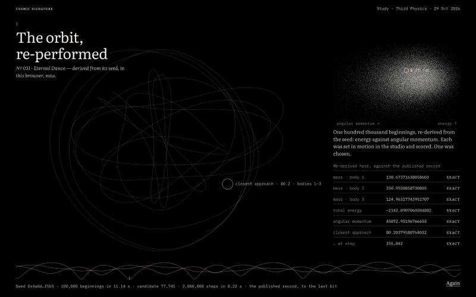
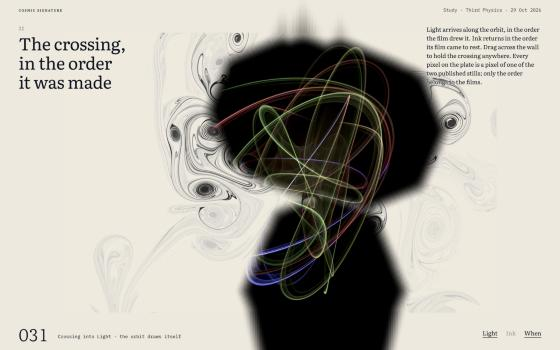
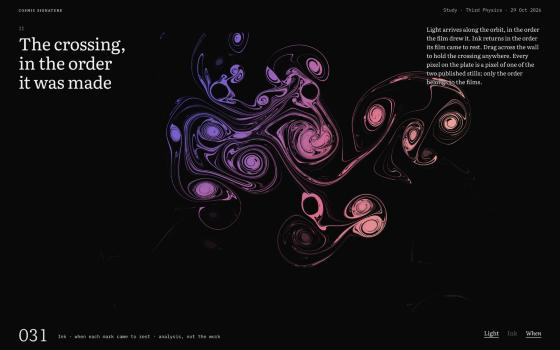
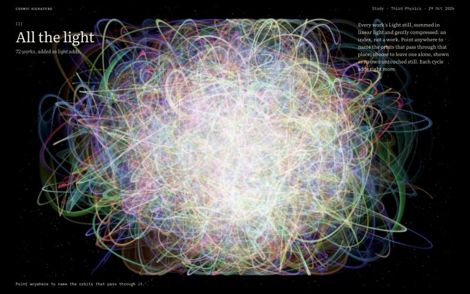

# Third Physics — physics, upon physics, upon the page

*Creative direction, 29 October 2026. Written against the Two Grounds venue as merged (Phases 0–2, [world-class-gallery-vision.md](world-class-gallery-vision.md)), the generator's source in `CS-Image-Generation`, the published media and metadata, a prior-art search, and a working study in [concepts/third-physics-v1](../concepts/third-physics-v1/README.md). Nothing here alters a pixel of any work or a word of any auction rule.*

---

## 0. In one minute

The venue is now a fine catalogue raisonné. It is also still a website *about* art: a header, sections, a viewer, captions, motion curves chosen by a designer. Nothing on it could exist only for this collection.

This collection has something no other artist's website can borrow: **its physics is exactly reproducible**. On 29 October 2026 this direction re-derived six works (000, 023, 031, 035, 060 and 071) from their published seeds in plain JavaScript. The port drew the 100,000 candidate beginnings from the seed's SHA3 stream, took the chosen one and integrated it for 2,000,000 Yoshida steps. For each work it reproduced the following to the last bit:
- the published masses;
- the total energy and the angular momentum;
- the closest approach, after up to 1.26 million steps of chaotic motion.

In Node this takes well under a second. The token metadata already says it: "Same seed, same pixels — re-render it to verify."

So the proposal is simple to state:

> **The art is physics upon physics: a recorded orbit drives a second physical system, light or a current. The venue becomes the third physics. Everything that moves on the site is moved by the work's own physics, re-performed in the visitor's browser and checked against the record.**

Three of its inventions already run in the study:
- **The orbit, re-performed:** every published measurement is marked *exact*.
- **The crossing in the order it was made:** Light arrives the way its film drew it, and Ink returns the way its film came to rest.
- **All the light:** the whole collection as one long exposure, from which a visitor can pull a single orbit.

---

## 1. Has anyone done this?

A prior-art search was run on 29 October 2026; sources are linked inline. The short answer: **every ingredient has a precedent, and the combination appears to have none.**

**Physics driving physics.** The closest relatives are:
- **Rod stirring and topological chaos in fluid science.** Three or more stirrers moving on prescribed paths mix a two-dimensional fluid ([Boyland, Aref & Stremler 2000](https://people.clas.ufl.edu/boyland/files/stir.pdf); figure-eight paths in [Thiffeault et al. 2008](https://arxiv.org/abs/0804.2520)). This is science, with designed paths. It is the nearest mechanism to Ink.
- **Particles emitting smoke and fire in VFX**, for example [SideFX Houdini](https://sidefx.com/docs/houdini/pyro/intro.html). This is plumbing, without seed, selection or artwork identity.
- **Data or bodies driving simulations:**
  - Akten and Quayola's [*Forms*](https://memo.tv/projects/2011/forms/), driven by athletes' motion;
  - Karl Sims's [*Flow*](https://karlsims.com/flow.html), driven by visitors;
  - Refik Anadol's [*Wind of Boston*](https://www.creativeapplications.net/project/wind-of-boston-data-paintings-by-refik-anadol-studios/), driven by wind data;
  - Naoko Tosa's [*Sound of Ikebana*](https://naokotosa.co.jp/?p=697), real liquid moved by sound.

  None of these is driven by a simulated physical system.
- **Ink and marbling simulation:**
  - naibdian's [*Nebula Ink*](https://www.raster.art/artwork/nebula-ink-by-naibdian/about) (fxhash, 2023) is the nearest visual neighbour, but scripted pencils drive it;
  - Amanda Ghassaei's [Navier–Stokes marbling](https://blog.amandaghassaei.com/2022/10/25/digital-marbling/);
  - [MoXi](https://history.siggraph.org/learning/moxi-real-time-ink-dispersion-in-absorbent-paper-by-chu-and-tai-2) ink dispersion;
  - [Mathematical Marbling](https://ieeexplore.ieee.org/document/5887299).

  Hands or scripts drive all of them, never an orbit.
- **Three bodies as art:**
  - aebrer's [*Three Body Problem Redux*](https://www.raster.art/artwork/three-body-problem-redux-by-aebrer/about) (fxhash, 2021) takes its starting conditions from the token hash;
  - Paweł Dudko's [*Gravity*](https://www.artblocks.io/marketplace/collections/gravity-by-pawel-dudko) (Art Blocks, 2023);
  - the scientific orbit galleries of [Šuvakov & Dmitrašinović](https://arxiv.org/abs/1303.0181) and [Li & Liao](https://numericaltank.sjtu.edu.cn/three-body/three-body.htm).

  In each of these the orbit *is* the image. There is no second physical system and no selection among candidates.
- **Diemer & Facio, [*The Fabric of the Universe*](https://arxiv.org/abs/1702.03897) (2017).** Cosmological N-body data became prints and a woven textile. This is a translation of shape, not a second simulation, and is the closest relative of Tidal Silk and the porcelain shell.

The search found **no** work in which a seeded three-body orbit, selected from many candidates and recorded once, drives one or more *different* second simulations published as paired expressions of a single token. The phrase "physics upon physics" did not turn up either.

Caveats: raster.art refused repeated requests, and social platforms and some artists' full catalogues were not searched. Finding nothing is not proof that nothing exists. Even so, the claim "physics upon physics" is defensible as this collection's own.

**The three website ideas**, checked for novelty:
- **A crossing driven by a work's own time-of-arrival map.** The *mechanism* is a known map-driven wipe ([After Effects Gradient Wipe](https://helpx.adobe.com/au/after-effects/desktop/apply-effects-and-animation-presets/list-of-effects/transition-effects.html), [GL Transitions](https://gl-transitions.com/)). What appears to be new is the map's *source and meaning*: it is measured from the work's own film and used between two renderings of one token.
- **An additive index of a collection.** Related work exists:
  - Jason Salavon's [averages](https://en.wikipedia.org/wiki/Jason_Salavon);
  - Hiroshi Sugimoto's [*Theaters*](https://edition.cnn.com/style/article/hiroshi-sugimoto-theaters), which expose one frame for a whole film;
  - [AverageExplorer](https://efrosprojects.eecs.berkeley.edu/averageExplorer), which lets users reweight a collection's average.

  None of them is a generative collection's index that grows each cycle and from which one work can be pulled out. **Partly novel.**
- **Re-deriving each work's physics in the browser and checking it against published measurements.** [Art Blocks](https://docs.artblocks.io/protocol/on-chain-generator/) and [fxhash](https://fxhash.notion.site/Code-of-Conduct-aa68920949a74c4287c219a561f4165e) re-*render* art from a hash, but neither checks anything against published physical measurements. Ricky Reusser's [notebook](https://rreusser.github.io/notebooks/periodic-planar-three-body-orbits) re-integrates published orbits without comparing them. **Appears novel.** The technical risk, determinism across browser engines, is low: the port uses only + − × ÷ and `Math.sqrt`, and `Math.sqrt` has been exactly specified since 2024 ([TC39 #3345](https://github.com/tc39/ecma262/pull/3345)).

**Patterns to avoid copying:**
- Rozendaal's one-work-per-domain;
- JODI's browser-as-material;
- Olafur Eliasson's associative archive;
- the real-time WebGL worlds of Lusion and Abeto, Awwwards Sites of the Year 2023 and 2024.

None of these is what follows.

---

## 2. Why the venue still reads as a website

Two Grounds fixed craft: the arrival, the edgeless plate, the Turn, the Resolution, the record. It kept the *grammar* of the web:
- a running head and sections;
- a seam that wipes in a straight line on a designer's curve;
- an index of thumbnails, in better order;
- data printed as text.

The physics, which is the whole subject of the art, appears only as numbers in a table.

**The test applied to every idea below:** *could this exist on another artist's website?* If it could, it is decoration. Each invention here needs this collection's physics to exist at all.

---

## 3. The thesis and its six laws

**Third Physics.** The orbit is the subject, and the materials (Light, Ink, and next Silk, Estuary, Shell and Crystal) are its performances. The venue is the third physical layer: downstream of the art, never upstream of it.

1. **Nothing moves on a designer's whim.** Every movement is caused by the work. That means either a re-performance of its orbit or a measurement of its films: when a mark arrived, where the current came to rest, how fast a body travelled. Durations stay tokens, for usability; shapes and orders come from the work.
2. **The work's pixels are never touched.** Physics happens around the plate, before it and between its expressions. A crossing shows only untouched pixels of the published stills, and only their *order* comes from the films.
3. **Every claim can be verified in the visitor's browser.** "Re-render it to verify" becomes an instrument on every work page, beside Verify a download. When a check fails, the page says so.
4. **One score, many performances.** The re-derived orbit is the invariant, shown once per work. Each material is a performance of it, with its own ground. Two Grounds becomes N grounds.
5. **Exactness is the ornament.** Numbers at full precision, set beautifully, are the venue's luxury: −2142.8907060284882, step 255,842, exact.
6. **Physics is the cheapest content.** An orbit is a seed and a few dozen numbers, so it costs nothing on the network. On a slow connection the physics arrives before the pictures.

---

## 4. What is already proven

The study ([README](../concepts/third-physics-v1/README.md)) runs three rooms against real data.

| Claim | Evidence |
|---|---|
| The generator's stream and integrator port exactly to JavaScript | [`orbit.js`](../concepts/third-physics-v1/orbit.js); Keccak checked against Node's `sha3-256` at ten message lengths; six works re-derived with every published mass, energy, angular momentum and closest approach (distance, pair, step) identical, including four ejection orbits |
| It is fast | Node: 0.1–0.65 s to derive candidate beginnings up to the chosen one; 0.22 s for 2,000,000 Yoshida steps |
| The films record *order* faithfully | In 031's Light film, 99.6 % of lit pixels stay lit, so marks stay where they were drawn and the arrival map is well defined. The Ink film ends on its still (proved for every settling clip in Phase 2), so every pixel has a well-defined moment after which it stops changing |
| The orders are beautiful and distinct | 031's Light drew its core first and its outer ellipses last; its ink came to rest in a sweep from upper left to lower right ([Light](../concepts/third-physics-v1/screenshots/09-when-031-light.png), [Ink](../concepts/third-physics-v1/screenshots/10-when-031-ink.png)) |
| The whole collection reads as one image | The 72 Light rungs summed in linear light ([1280 px](../concepts/third-physics-v1/screenshots/11-all-the-light-1280.png)) |

One finding changes a sentence in the process essay. For 031, **all 100,000 beginnings pass the generator's cheap energy and angular-momentum gate**, so the choosing happened entirely in the million-step simulations and the Borda vote.

---

## 5. The inventions

Each invention is given with what the visitor meets, why only this art can have it, how it works, and its status.

### 5.1 The orbit, re-performed *(built in the study)*

**The visitor meets** this on a black field. Three points of light, sized by their masses and tinted by their published body hues, trace the work's actual orbit at the film's own pace. Beside them is a table: *mass · body 1 · 130.67371638058603 · exact*, down to *closest approach · 80.20379580764032 · exact*. The readout line says what happened: *Seed 0x4a0d…f5b5 · 100,000 beginnings · candidate 77,741 · 2,000,000 steps · the published record, to the last bit.*

**Why only here.** No other collection publishes a selected, deterministic physical record whose integrator can be ported and checked.

**How.** The worker port shown in the study. For production:
- compile the generator's own `sim.rs` and `sha3` to WebAssembly, so that what runs is the generator's code, not a port;
- ship each work's chosen initial state in the registry, so motion starts at once while the full derivation verifies in the background;
- run a CI job that re-derives all 72 works in Node, Chromium, WebKit and Firefox and fails on any bit of difference.

### 5.2 The crossing, in the order it was made *(built for every work)*

**The visitor meets** this when pressing `Light`. Night does not wipe across the plate: it blooms out of the orbit's core, where the film first drew. The ribbons arrive along their own paths, and the room's walls darken last as the front leaves the sheet. The running head and label invert letter by letter as the front crosses them. Pressing `Ink` brings the paper back in the order the sumi came to rest.

**Why only here.** It needs two renderings of one orbit *and* films that end exactly on their stills. The crossing differs for every work, because every work was made in a different order.

**How.**
- A per-work, per-expression arrival map: 576 px, 8-bit, 17–28 KB as PNG and under 10 KB as lossless WebP for 031. It is cut offline by `scripts/build-arrival-maps.mjs` with the same relay and hash discipline as the settling clips.
- A small WebGL pass composites the two stills by `smoothstep(p ± ε, map)`. The walls take the nearest edge's time plus distance.
- The three drivers of the Turn stay: the word `Light`, a drag that completes past 40 %, and scroll.
- Under reduced motion, Pause or Hush, the crossing is one frame.
- The straight seam remains the fallback for when WebGL is unavailable.

### 5.3 Three lenses: When, Wavelength, Detail *(When built)*

Museums show a painting in infrared and X-ray. This venue gets three truthful lenses on every plate:
- **When**, the arrival map coloured from early to late over the marks themselves;
- **Wavelength**, the published spectral sweep and bins;
- **Detail**, the loupe, already built.

Each lens is labelled *analysis, not the work* and is never used on a sharing card.

### 5.4 All the light *(built)*

**The visitor meets** the collection as a single exposure: every Light still added as light adds, white-hot where orbits crowd and coloured at the edges.
- Point anywhere and the orbits through that place light up and name themselves, for example *№ 061 · № 004 · № 033 …*.
- Choose, and the rest of the sky goes dark around one orbit. That orbit is then shown as its own untouched still, and from there it can walk to its page.
- A cycle control replays the sky filling cycle by cycle. Every new cycle adds its orbits to it (24 in each of the first three), so the index itself is a living, growing work of record.

**How.** As planned: the GPU accumulates in a half-float target from the 1280 (or 640) rungs, with a precomputed coarse luminance grid for naming, about 1 MB of previews in production. As built: the sky is summed offline in linear light, after each cycle, and the page shows one image of 0.3–0.6 MB ([third-physics-phase-c.md](third-physics-phase-c.md)).

### 5.5 The score: the transport becomes physics

The 1 px time line under every playing film becomes the orbit's score:
- the three pairwise separations, at 1 px;
- ticks at the closest approach, at each syzygy and at each braid crossing.

A visitor can jump the film to *the closest approach*. During playback the label strip reads the live physics, for example *bodies 1–3 · 80.2 apart*, because the re-performance and the film share one clock.

This needs two things:
- the step ↔ film-time map verified per film. Light is 1,802 frames for the 1,000,000 recorded steps, to be confirmed. The Ink films carry their own timing and pre-roll, as [art-presentation-research.md](art-presentation-research.md) warns.
- a port of `detect_syzygies` and the braid crossing detector, verified against the published counts and the braid word.

### 5.6 After the frame: fate

The traits say *Eternal Dance* or *Ejection*. The generator decided this over an 8,000,000-step horizon, longer than the film. When a film resolves into its still, the venue can offer what no film shows: `After the frame`. The re-performance continues past the recorded window at the same pace. For an ejection, the escaping body leaves the drawing at the published `ejection_step`; for an eternal dance, the orbit keeps turning until the visitor leaves.

The artwork stays the recorded rendering; this is its physics, continued and labelled as such. *Every motion has an echo* finally has a literal page.

### 5.7 The Orrery: the collection, moving, for zero megabytes *(built)*

This is a physical index beside All the light: every work's orbit re-performed at once as a small live score, hung by cycle, with the work's numeral beneath. Hover to see the plate.
- The registry carries each work's state at the start of its recorded window: 18 doubles per work, about 10 KB in binary or a few tens of kilobytes as JSON for the whole collection.
- Integrating 72 orbits at film pace is about 2.4 million steps per second. That is a fraction of one core; the study measured about 9 million per second in Node.

It is the only thumbnail wall on the web whose thumbnails are physics rather than pictures.

### 5.8 The Overture: the art condenses out of its physics

The home page on a first visit:
1. **0 s.** Black, and the day's work's three bodies begin their orbit, live and verified.
2. **About 1 s.** The trails start to draw.
3. **Over about 6 s.** Where the orbit has passed, the real Light still condenses in the order its film drew it, on the same clock.
4. **Then.** The crossing to Ink, in the order the ink came to rest, and the running head arrives last.

Any input completes the Overture instantly. Reduced motion and returning visitors get the plate at once.
- **Version 1** synchronises the two clocks, with the score and the plate side by side.
- **Version 2** registers them by porting the camera drift and framing (`drift.rs` plus the fit, about 600 deterministic lines, checked against the Light film's frame differences). The bodies then literally draw the plate.

This is the one timed event of the venue and replaces the Dusk.

### 5.9 Opening night, physics first

The generator chooses a cycle's eight orbits in stage 1, hours before the renders finish. If it publishes `nft_traits.json` first, `/auctions` can show the eight new orbits re-performed and verified while the renders are still being made. Each plate then condenses out of its score as its media publishes and hash-checks.

This is the true order of making, staged as the event. Readiness and eligibility stay separate facts; there is no clock but the contract's.

### 5.10 The choice

The process essay's first chapter re-derives all 100,000 beginnings of the day's work in the visitor's browser and shows them as a field of energy against angular momentum, with the chosen one ringed. The Borda weights sit beside it.
- The text is exact: every beginning passed the quick gate, every one was set in motion in the studio for up to 1,000,000 steps, and one was chosen.
- The studio's search itself (10¹¹ steps) cannot run in a browser, and the page says so.

### 5.11 Many physics: the shelf

The artist's newer interpretations of the same frozen orbit are a cloth simulation (Tidal Silk), pigment transport (Estuary), a porcelain shell, polarised crystal optics and sculpture. They need an architecture that does not assume two expressions.
- A work page shows **the score once** and its performances as plates, each on the ground sampled from its own render.
- The crossing generalises: any material with a film has an arrival map.
- The Two Grounds tokens become a ground registry.
- Nothing ships as a promise: a material appears on a work only when its package exists.

### 5.12 Verify an orbit

This is a public page beside Verify a download. Enter any token number, and the browser re-derives its orbit and prints the comparison, line by line. It is the collection's description sentence made into a tool.

---

## 6. The venue, re-composed

- **Home:**
  1. the Overture (first visit only);
  2. the day's work in Ink, with the crossing to Light;
  3. the score of its film;
  4. All the light, as the door to the collection;
  5. the statement;
  6. the colophon.

  The Dusk retires: the Overture is the single timed event.
- **Work page:**
  1. the plate and the crossing;
  2. the score with its verification;
  3. the three lenses;
  4. the gatefold;
  5. the entry;
  6. After the frame;
  7. files, Verify a download and Verify an orbit;
  8. provenance.
- **Collection:** three physical orderings join the existing ones. All the light (Light), the Orrery (physics) and the plate sequence (Ink) sit beside Number, Cycle and Spectrum in the Index sheet.
- **Process:**
  1. The choice;
  2. the orbit;
  3. Light, with its crossing;
  4. Ink, with its crossing;
  5. the shelf of further materials, as they arrive.
- **Auctions:** opening night physics-first, then the bound catalogue as built, with Hush unchanged. The bid panel does not change.

---

## 7. What this changes in the standing rules

These are deliberate reversals or extensions of Two Grounds decisions. Each needs the owner's yes.

1. **Live computation in the visitor's browser.** The colophon keeps "the displayed films are recorded renderings of the artwork, not live simulations" and adds: "the orbit beneath each work is re-derived in your browser from its seed." The vision's ban on "living marks" assumed there was no trustworthy trajectory to draw; that premise is gone.
2. **Interleaved crossings.** The straight seam already composites two untouched stills. The arrival-map crossing does the same with a different, authored-by-the-work mask, and for about two seconds the frame mixes both expressions.
3. **Derived views.** All the light and When are new images derived from the works. They are always labelled, never offered as works, never used on sharing cards and never sold.
4. **One timed opening.** The Overture replaces the Dusk as the venue's single automatic event. It plays on the first visit only and any input completes it.
5. **Colour outside the plates.** The When lens and the score use colour, drawn from the works' own published hues or a stated time ramp. The chrome stays monochrome.
6. **Pipeline asks of the generator team:**
   - publish the candidate stream offset, or the chosen initial state, so the masses become an independent check;
   - publish `nft_traits.json` before the renders, for opening night;
   - optionally, a WebAssembly build of `sim.rs`.

---

## 8. The plan

Each phase ships behind a flag, on its own branch, with the existing seven-project Playwright matrix, axe, the 12 px floor and eight locales.

**Phase A — the orbit, re-performed (2–3 weeks).** *Shipped 29–30 October 2026; see [third-physics-phase-a.md](third-physics-phase-a.md).*
- `src/lib/physics/`: the port (or WebAssembly), a worker, and a registry of chosen initial states and window-start states built by `scripts/build-orbit-records.mjs`.
- The score panel and Verify an orbit on every work page.
- A CI test re-derives all 72 works exactly in Node and the browser projects.
- Text equivalents for screen readers ("Three bodies of masses 130.7, 251.0 and 125.0 … closest approach 80.2 at step 255,842, 7.7 s into the film").
- Settled first: the profile-offset question (§7.6) and the step ↔ film map.

**Phase B — the crossing (3–4 weeks).** *Shipped 29–30 October 2026; see [third-physics-phase-b.md](third-physics-phase-b.md).*
- `scripts/build-arrival-maps.mjs` for 72 Light films (about 4 MB each) and 71 Ink films. It decodes the published films once at reduced resolution. The 96 MB originals stream through the existing relay, about 7 GB read once, and only the maps are kept.
- The WebGL crossing replaces the straight seam in all four places.
- The When lens in the room.
- Visual regression on three works, and reduced-motion parity.

**Phase C — the indexes (2–3 weeks).** *Built 30 October 2026; see [third-physics-phase-c.md](third-physics-phase-c.md).* All the light, with naming, pull-out and the cycle replay; the Orrery; both added to the Index sheet.

**Phase D — the events (3–4 weeks).**
- The Overture, version 1 then version 2 with drift registration.
- After the frame.
- The choice in the process essay.
- Opening night physics-first, once the pipeline publishes traits early.

**Phase E — many physics.** The ground registry and the shelf, each material shipping when its package is published.

---

## 9. Risks

- **Engine determinism.** Expected to hold, because only + − × ÷ and sqrt are used. CI proves it per engine. If an engine ever differs, the page prints *differs* and never hides it.
- **Phone CPU.** In the study's pure-JavaScript Keccak, deriving all 100,000 beginnings takes about 1.6 s in Node; a phone, or a page throttled in a background tab, takes much longer (the hidden in-app browser reported 11 s). Mitigations: ship the chosen state for instant motion; derive the full chain only on `Verify`, or in WebAssembly; never block the plate.
- **Arrival-map edge cases.** Dense overlaps interleave times at pixel scale; the study blends 50 % raw time with 50 % smoothed time to keep the front coherent. Ink films with pre-roll or trimming need per-film checks. Each map is hashed against its film.
- **Derived images mistaken for works.** Mitigations are labelling rules, exclusion from metadata, sharing cards and sitemaps, and a test that fails if a derived view is reachable from a sale surface.
- **Intro fatigue.** The Overture plays on the first visit only, any input completes it, and it is never shown on artwork, lot or process pages.
- **GPU memory for All the light.** Use 640 px textures on phones, a single texture array, and a static fallback image.

---

## 10. Considered and set aside

- **Bending the page's hairlines as geodesics around the masses.** Lovely in a sketch, but it means continuous chrome motion: decoration that fails §2's test.
- **The cursor as a test particle in a work's field.** A physics toy. It is kept only as a possible laboratory page, never near a plate.
- **Scrubbing films by scroll, a live fluid around the plate, a virtual 3D gallery.** Still no, for the reasons given in the Two Grounds vision.
- **Sound.** Still a commission or nothing. One new option is truthful: a close-encounter "chirp" computed from the re-derived accelerations, opt-in and credited, never automatic.

---

## 11. Decisions for the owner

1. **Direction.** Adopt Third Physics on top of Two Grounds, including the rule changes in §7.
2. **The Overture.** Should it replace the Dusk as the home's one timed event on first visits?
3. **Derived views.** Should All the light and the When lens be public, labelled as analysis?
4. **Pipeline.** Will the generator team publish the stream offset (or initial state) and early traits, and consider a WebAssembly build of `sim.rs`?
5. **Order of work.** The recommendation is Phase A then B, because the re-performance underpins everything else and the crossing is the most visible change.
